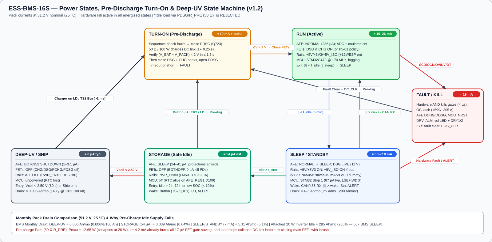

# Research 07 — Operating Power States, Sleep, Deep-UV Shutdown & Pre-Discharge Trade-Off (2026-11-25)

**Sources verified directly:**
* TI BQ76952 Datasheet (`ZHCSM58B`): `7.5 Supply Current` (p.10–11: `INORMAL` 286 µA typ, `ISLEEP_1` 41 µA typ, `ISLEEP_2` 24 µA typ, `IDEEPSLEEP_1/2` 10.7 / 9.2 µA typ, `ISHUTDOWN` 1 µA typ / **3.1 µA max**), `7.6 Digital I/O` (`ROH` TS2 weak pull-up 4600 kΩ, p.11), `13.2–13.5 Functional Modes` (p.53–55).
* ST STM32G473RCT6 Datasheet (`DS12712` Rev 2): `Table 33 Stop 1` (p.105: `81.5–84.5 µA` typ @ 3.0–3.6 V, RTC w/ LSE `87 µA` typ, `845 µA` typ / `2400 µA` max @ 85 °C), `Table 35 Standby` (p.106–107), `Table 36 Shutdown` (p.108–109).
* TI `LM5013DDAR` Datasheet (`SNVSCB3`, p.5–6): `IQ_SDN = 3.1 µA typ / 9.9 µA max`; `TPS7B8233-Q1`; `TPS22918` (`0 µA` QOD off); `SN6505B-Q1` (`SLLSF95D`); `TLV76750`.
* Sheet 07 power stage specs ([`sheet07_power_stage.md`](../design/sheet07_power_stage.md)): `R_PRE` = **50 Ω / 100 W**, `Q723` `IRF9640S` + `D712` blocking diode (`Vf ≈ 0.9 V`).

---

## 1. Proposed 6-State Machine (`RUN → SLEEP → STORAGE → DEEP-UV / SHIP + FAULT + TURN-ON`)

| State | AFE Mode | Main FETs & Path | Control Board Rails | MCU State | Entry Condition | Exit / Wake Paths |
|---|---|---|---|---|---|---|
| **TURN-ON** (Pre-dsg) | `NORMAL` | `PDSG` (`Q723`) on; main banks OFF | All logic ON (`PWR_HOLD = 1`) | Active (`170 MHz`) | Wake trigger from `STORAGE` or `DEEP-UV`, or recovery from `FAULT` | `(V_BAT − V_PACK) < 2 V` within `≤ 1.5 s` → close `DSG`+`CHG`, turn `PDSG` off → **`RUN`**; timeout → **`FAULT`** |
| **RUN** | `NORMAL` (286 µA) | `DSG` & `CHG` ON (or per P5-01 charge policy) | `+5V` / `+3V3` / `+5V_ISO` ON (`+12V`, `+3V3_ESP` on demand) | Active (`170 MHz`), logging & CAN/485 | Pre-discharge passed | `|I_pack| < I_idle` (e.g., `< 0.3 A`) for `t_sleep` (e.g., 5 min) → **`SLEEP`**; any trip → **`FAULT`** |
| **SLEEP** (Bus-ready standby) | `NORMAL ↔ SLEEP` (`41 µA` w/ 11 V pump) | **`DSG` ON** (live pack output; `CHG` on or off per policy) | `+5V` / `+3V3` ON; `+5V_ISO` ON if listening on CAN/485 | `Stop 1` (`87 µA` typ @ 25 °C; IWDG + LSE active) | Inactivity `> t_sleep` while bus or inverter standby needed | `|I_pack| > 0.5 A` (`WDT`/wake comp.), CAN/RS-485 RX activity, button → **`RUN`**; idle `> t_storage` (e.g., 24–72 h) or low SOC (`< 5–10%`) → **`STORAGE`** |
| **STORAGE** (Safe idle, FETs off) | `SLEEP` (`24 µA` typ, protections armed) | **OFF** (`FET_EN = 0` → `BOTHOFF`, `0 µA` kill pull-down draw) | **`PWR_EN = 0`** (`+5V/+3V3/+5V_ISO` OFF; `LM5013` ≤ `9.9 µA`) | Unpowered; **RTC stays alive** on `VBAT_MCU` (`AFE_REG1` via `D109`) | Long idle `> t_storage` or low SOC cutoff (`V_cell < 2.80–2.90 V` w/ hysteresis) | Push-button (`WAKE_BTN_N` / `Q101`), AFE `ALERT` (`Q102`), charger on `LD/PACK` (`Q201` / `WAKE`), optional bus wake → **`TURN-ON`**; `min V_cell < 2.50 V` → **`DEEP-UV`** |
| **DEEP-UV / SHIP** | **`SHUTDOWN`** (`1 µA` typ / `3.1 µA` max, DS p.11) | **OFF** | **ALL OFF** (`AFE_REG1 = 0`, `PWR_EN = 0`) | Off (**RTC lost** unless supercap added) | Persistent `min V_cell < 2.50 V` (for e.g. `60 s` to protect cell against over-discharge) or Ship CLI command | Physical **`TS2` wake button** (lowers `TS2` `< 0.6 V`, DS p.76) or **charger `> 5 V` on `LD`** (`WAKE` via `PACK+`) → boot into **`TURN-ON`** |
| **FAULT** | `NORMAL` (`FLT` asserted) | **OFF** (`U701` AND kills gates hardware-fast) | `+5V` / `+3V3` / `+5V_ISO` ON (`ALM` LED red, `DRY` active) | Active: logs fault to FRAM/Flash, broadcasts over CAN/BLE | Any SCD / OCD / hardware OC latch / COV / CUV / OT / UT / open-wire | Fault cleared + recovery timer + `OC_CLR` (if OC latched) → **`TURN-ON`** (or drop to `STORAGE`/`DEEP-UV` if CUV persists) |

> **Important schematic note (D-01 vs "SLEEP with FETs On"):** In `ARCHITECTURE.md` §4.3 (`D-01`), `FET_EN` has a 100 kΩ pull-down on Sheet 07 so turning off `+3V3` (`PWR_EN = 0`) drops both main FET banks immediately. Therefore, a **bus-ready SLEEP mode with FETs live requires `+3V3` / `PWR_HOLD` to stay ON** (i.e. Standby/Stop 1 at `~5.5–7 mA`), whereas **true µA `STORAGE` turns `PWR_EN` off (`~54 µA`) with `PACK+` open** until woken by button, charger, or an optional µA bus-wake circuit.

---

## 2. Current Budget & Monthly Pack Drain (v1.2 Hardware, 51.2 V, 25 °C)

**v1.2 update vs `v1.0` Baseline:** Replacing `B0505S-2WR3` + `150 Ω` dummy load (`~109 mA` on `+5V`) with `SN6505B-Q1` + `TLV76750` (`~32 mA` idle on `+5V` when `EN_ISO = 1`, zero dummy load) reduces `+5V` idle draw by `~77 mA` (`~9 mA` pack current at `51.2 V` / η ≈ 85%). Restoring `LM5013DDAR` avoids the v1.1 LM5146 FPWM `+6 mA` standby penalty and `+10–20 µA` shutdown penalty.

| State | Itemized Consumption (calc / est.) | Pack Current `I_pack` | Drain (Ah/mo, 730 h) | % of 100 Ah / mo | % of 280 Ah / mo | Time 10% → 0% (100 Ah / 280 Ah) |
|---|---|---|---|---|---|---|
| **DEEP-UV / SHIP** | BQ76952 `SHUTDOWN` (`1 µA` typ / `3.1 µA` max, DS p.11) + `LM5013` shutdown (`3.1 µA` typ / `9.9 µA` max, `SNVSCB3` p.6) + `LM5163` + diode/MLCC leakage | **8 µA typ** (35 µA max) | `0.006 Ah` typ (`0.026` max) | **0.006%** | **0.002%** | **143 yr** / **400 yr** (typ) |
| **STORAGE** (`PWR_EN = 0`) | BQ76952 `SLEEP` (`24 µA` typ, DS p.11) + `REG0` NPN + `AFE_REG1` pull-ups/LSE (`~12 µA`) + `LM5013` SD (`3.1 µA`) + HV divider/leakage (kill PDs = `0 µA` with output off) | **≈ 54 µA est.** (`40 µA` typ / `80 µA` worst) | `0.039 Ah` est. (`0.058` max) | **0.039%** | **0.014%** | **21–28 yr** / **60–80 yr** |
| **SLEEP / STANDBY** (`FETs on, Stop 1`) | STM32 `Stop 1 + RTC` (`87 µA` on `3.3 V`) + AFE `NORMAL/SLEEP` + `TPS7B8233` IQ + `INA240` (`~2.3 mA`) + `TLV1702` + `LM5013` buck (`~2.1 mA` @ 70 mA) + **CA-IS iso on `SN6505B-Q1` (`~32 mA` @ 5 V = `~3.8 mA` pack, `EN_ISO = 1`)** or `0 mA` (`EN_ISO = 0`) | **≈ 4.5 mA** (`EN_ISO = 0`) / **≈ 5.5–7.0 mA** (`EN_ISO = 1`, est.) | `3.3–5.1 Ah` | **3.3–5.1%** | **1.2–1.8%** | **59.5 d** / **167 d** (`7 mA`) |
| **RUN (Active)** | STM32 `170 MHz` + AFE + SPI/mux/LEDs (`19 mA` typ; `26 mA` w/ Wi-Fi active) | **19 mA** (`26 mA` Wi-Fi) | `13.9 Ah` (`19.0 Ah`) | **13.9%** (`19.0%`) | **5.0%** (`6.8%`) | **21.9 d** / **61.4 d** (`19 mA`) |
| **Attached Inverter (Idle 20 W)** | **20 W continuous AC/DC tare** (`P / 51.2 V` @ 100% eff) | **391 mA** (+ BMS ≈ **400 mA**) | **285–292 Ah** | **285%** | **102%** | **25.6 h** / **71.8 h** |
| **Attached Inverter (Idle 30 W / 50 W)** | `30 W` (`0.59 A`) / `50 W` (`0.98 A`) | **0.59–0.98 A** | **428–713 Ah** | **428–713%** | **153–255%** | **17 h / 10 h** (100 Ah) |

**Key takeaway:** BMS quiescent current (`54 µA` in `STORAGE` = `0.04 Ah/mo`; `~6 mA` in `SLEEP/STANDBY` = `4.3–5.1 Ah/mo`) is dwarfed **50× to 7,000×** by inverter idle consumption (`20–50 W` = `285–713 Ah/mo`). A `100 Ah` pack drained to 10% SOC (`10 Ah` left) survives **28+ years** in BMS `STORAGE` and **60 days** in BMS `SLEEP`, but dies in **25 hours** if a 20 W inverter stays connected!

---

## 3. CAN / RS-485 Wake Receiver Analysis (Needed for Bus Wake from `STORAGE`?)

* **Current limitation:** When the BMS drops into true µA **`STORAGE` (`PWR_EN = 0`, `EN_ISO = 0`)**, the isolated supply `+5V_ISO` and transceivers (`CA-IS3050CW` / `CA-IS3082WX`) are **completely unpowered**. The unit therefore **cannot wake from CAN or RS-485 bus traffic** in `STORAGE` without additional hardware — wake is strictly via Push Button, Charger (`LD`/`PACK+`), or AFE `ALERT`.
* **Do we need a µA bus-wake receiver?**
  - **Inverter bus / Parallel link:** Stationary inverters (`500 kbps` CAN) either run in `Standby` (`~5.9 mA` BMS draw = `< 1.8%/mo` on `280 Ah`) where the transceivers stay powered, or have an inverter hard-power switch / charger voltage trigger (`LD` pin wake already supported!).
  - **Zero-standby-power isolated bus wake option (if desired later):** An ultra-low-quiescent isolated optocoupler wake detector (such as Lite-On **`LTV-217`** `Viso = 3.75 kVrms`, dark current `ICEO ≤ 100 nA` @ 50 V, DS p.5, driven via AC-coupled bridge rectifier across CANH/CANL or RS-485 A/B with ≥ 1 kΩ series limit) only works if the remote master sends a **high-amplitude wake pulse (`≥ 1.5–2 mA` into the LED to meet CTR ≥ 50% at `-40 °C`)**. On standard CAN (differential swing `1.5–3 V` across `60 Ω` bus load), tapping `≥ 2 mA` passive LED current loads the bus edges and violates ISO 11898 common-mode limits unless an isolated wake bias exists on `GND_ISO` — which itself requires isolated standby power!
  - **Verdict:** **Do NOT add a passive CAN/RS-485 opto-wake receiver to `v1.2`.** Keep bus listening inside **`SLEEP/STANDBY` (`~5.5–7 mA`)** where `CA-IS3050CW` / `CA-IS3082WX` already give compliant wake without distorting the isolated bus, and drop to `STORAGE` (`54 µA`, button/charger wake) after `24–72 h` of complete inactivity. Revisit only if an isolated standby CAN-wake transceiver (`TCAN1043`/`TJA1043` class behind an isolated micro-supply) is mandated by customer spec.

---

## 4. Verdict on Owner Idea: *"Run the Idle Load Through the Pre-Charge Path (`PDSG`) to Save Battery"*

**VERDICT: NO — Physically non-viable and dangerous. Reject completely.**

Verified calculations (`drain.py` against Sheet 07 `Q723` `IRF9640S` + `R_PRE = 50 Ω / 100 W` + `D712` diode `Vf ≈ 0.9 V`):

1. **Negligible battery savings:** Keeping `DSG` in source-follower mode vs 11 V charge-pump overdrive (`ISLEEP_1 41 µA` vs `ISLEEP_2 24 µA`, BQ76952 DS p.11) or dropping `DSG` to save gate drive saves **at most `17 µA` (`0.87 mW`, `0.012 Ah/mo`)**. Even **`4.2 mA` of load current** through `50 Ω` dissipates `I²R = (4.2 mA)² × 50 Ω = 0.88 mW` — wiping out 100% of the savings!
2. **Voltage collapse on real ESS idle loads (`P_max = 12.65 W`):** Modeling a constant-power inverter/DC load (`VL = [(Vbat−Vd) + sqrt((Vbat−Vd)² − 4·P·R)] / 2`) across `R_PRE = 50 Ω`:
   * At `51.2 V` (`Veff = 50.3 V`), the theoretical maximum deliverable power is **`P_max = 50.3² / (4 × 50) = 12.65 W`** (where `PACK+` sags all the way to **`25.2 V`**, tripping every 48 V inverter UVLO!).
   * To keep `PACK+ ≥ 44.0 V`, load current is capped at **`≤ 126 mA` (`≤ 5.5 W`)** — with `0.63 W` + `0.10 W` wasted in `R_PRE`/`D712`.
   * A typical **`20 W` (`~0.4 A`) or `30–50 W` inverter idle** causes **immediate link collapse (`P > 12.65 W`, no stable operating point)**: `0.4 A × 50 Ω = 20 V` drop (`8 W` continuous heat in a non-heatsinked pulse resistor!).
3. **Destructive inrush & latch/FET hazard:** Any brief inverter capacitor-refresh or compressor/fan pulse (`dV/dt = 11.5 V/ms` on `5 mF` under a 3 kW step) collapses `PACK+` before firmware reacts, or triggers uncontrolled main-FET closure (`E = ½ C ΔV² = 0.53–3.12 J` dump for `ΔV = 14.5–25 V`) causing `DSG` bank turn-on stress or nuisance `OC_TRIP` latch!
4. **Correct architecture:** Keep **`PDSG` (`Q723` + `50 Ω`) strictly as a < 1.5 s turn-on pre-discharge step** to charge the inverter DC link before closing `DSG`. Save battery cleanly using `SLEEP` (`FETs on`, `~5.5–7 mA`), `STORAGE` (`FETs off`, `~54 µA`), and `DEEP-UV` (`SHUTDOWN`, `~8 µA`).
